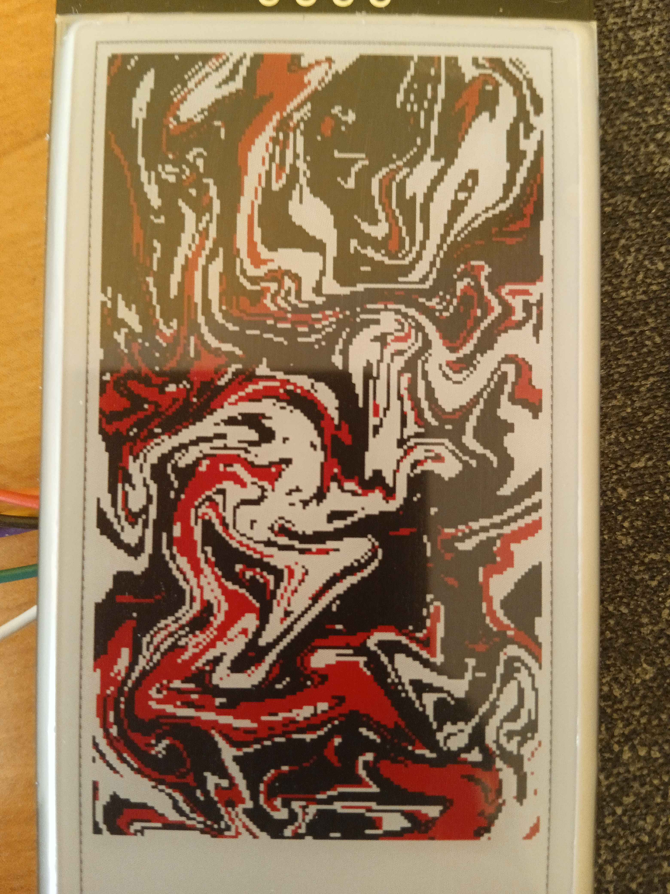
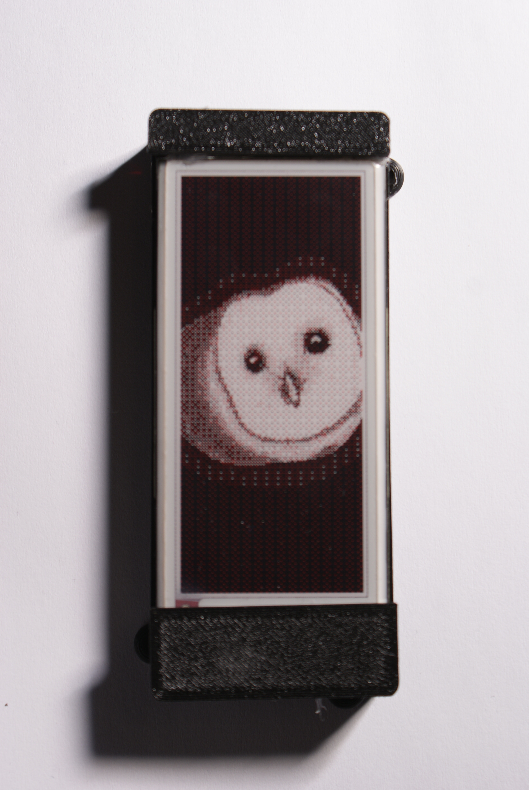
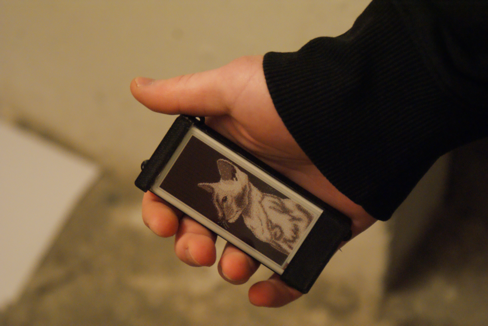
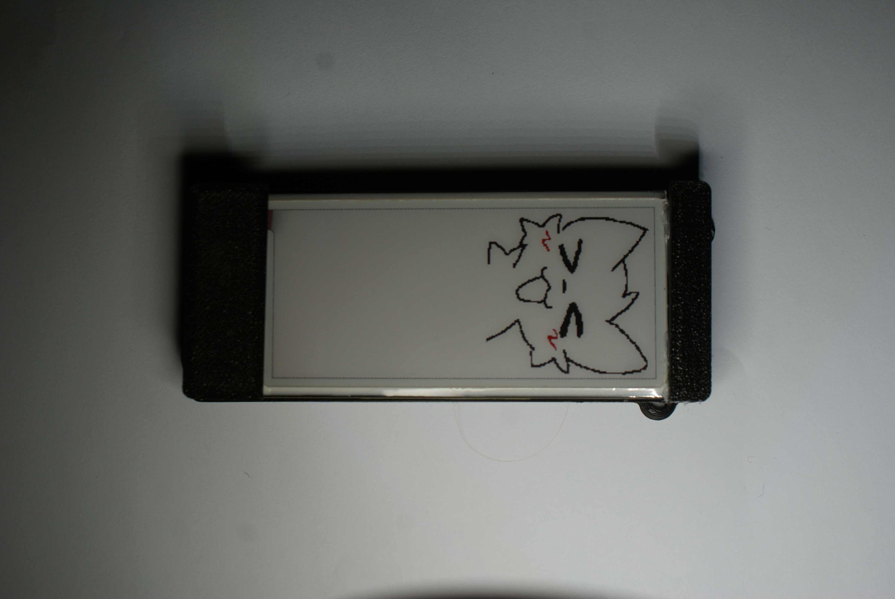
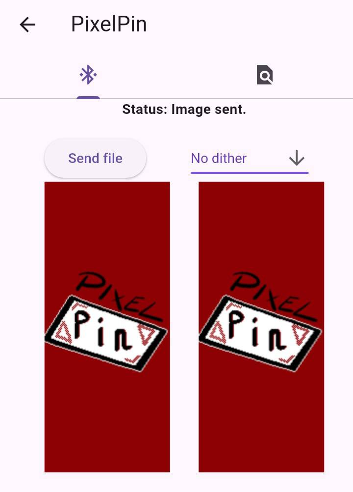

# PixelPin

PixelPin is a wearable e-paper display pin powered by an ESP32. It receives images over Bluetooth Low Energy (BLE) from a companion Flutter app using a custom binary protocol, applies Floyd-Steinberg dithering to convert full-color images to a 3-color (black, white, red) palette, and renders them to a 2.9-inch tri-color e-paper display. The device enters deep sleep after 5 minutes of inactivity and wakes on a button press, making it suitable for wearable use.

This repository contains the app code written in Dart/Fluter. The companion ESP32 firmware along with more documentation lives at [pixelpin](https://github.com/mikolajlubiak/pixelpin).

## Showcase

<h3 align="center">Device</h3>
<p align="center">
  <a href="docs/epd2.jpg"></a>
  <a href="docs/epd6.jpg"></a>
</p>

<p align="center">
  <a href="docs/epd1.jpg"></a>
  <a href="docs/epd3.jpg"></a>
  <a href="docs/epd4.jpg"></a>
  <a href="docs/epd5.jpg"></a>
  <a href="docs/epd7.jpg"></a>
</p>

<h3 align="center">App</h3>
<p align="center">
  <a href="docs/app1.jpg"></a>
  <a href="docs/app2.jpg"></a>
</p>

## Features

- **BLE image transfer** using a custom binary protocol with text-based command framing and raw binary data streaming
- **Floyd-Steinberg dithering** for high-quality 3-color (black/white/red) rendering on e-paper
- **Custom state machine** for reliable chunked BLE transfers across multiple write operations
- **Dual display support**: 2.9-inch tri-color e-paper (primary) or 240×320 TFT LCD (via compile flag)
- **Power management**: deep sleep after 5 minutes of inactivity, GPIO wake-up on button press (ESP32-C3)
- **Flutter app** for image selection, processing, and BLE transmission
- **Companion ESP32 firmware** in C++ using the Arduino framework via PlatformIO

## How It Works

```
Phone App  ──BLE──►  ESP32  ──RGB565──►  Dithering  ──1-bit buffers──►  E-Paper Display
(Flutter)             |                  (Floyd-                          (black/white/red)
                      |                   Steinberg)
                      └── Deep sleep after 5 min inactivity
```

1. The Flutter app converts the selected image to RGB565 format and sends it over BLE using the [custom binary protocol](docs/BLE_PROTOCOL.md).
2. The ESP32 firmware receives the image in chunks, accumulating data into two 1-bit framebuffers (monochrome and color).
3. After the full image is received, the firmware runs Floyd-Steinberg dithering, mapping each pixel to one of three values: black, white, or red.
4. The two framebuffers are sent to the e-paper display driver (GxEPD2), which handles the SPI communication and display refresh cycle.
